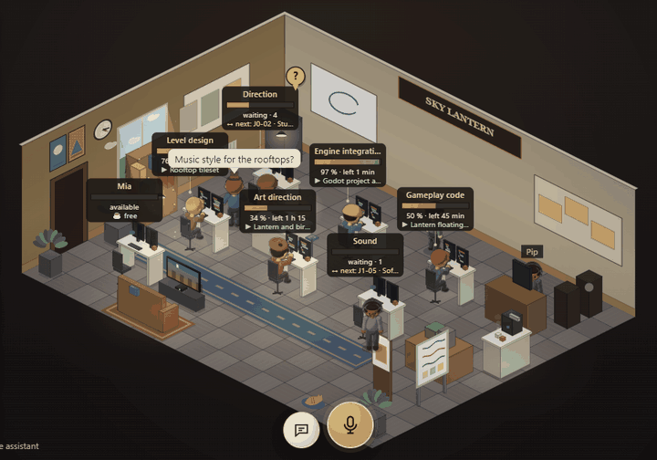
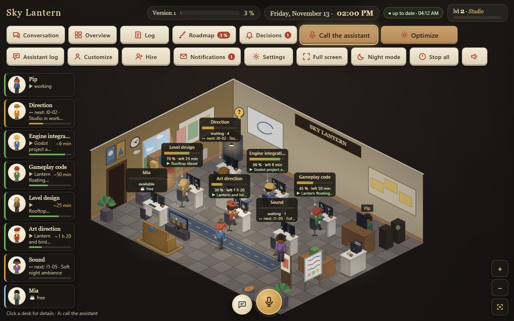
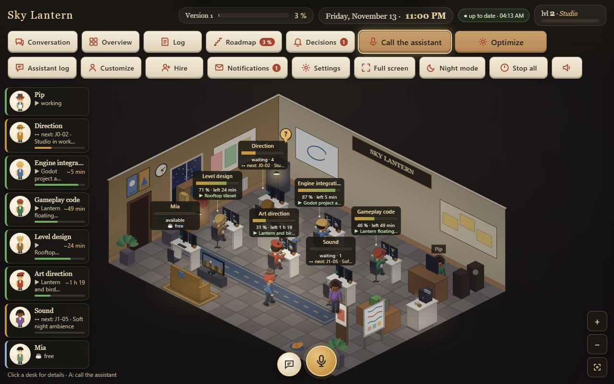
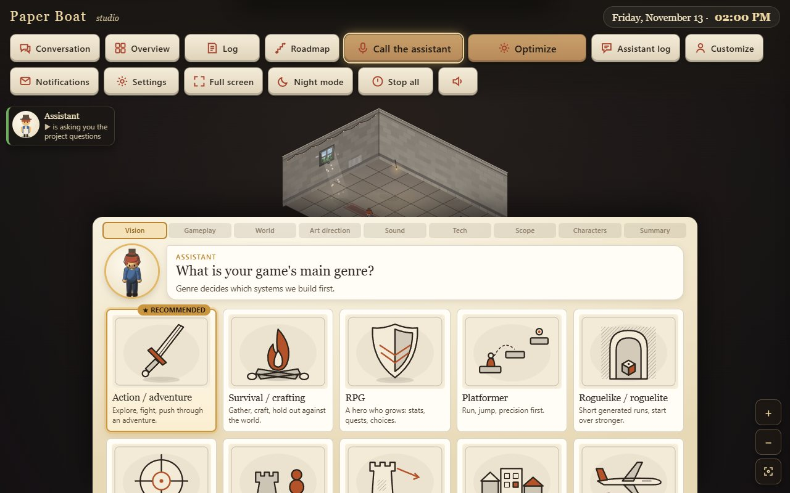
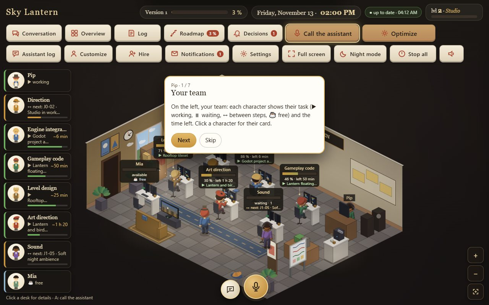
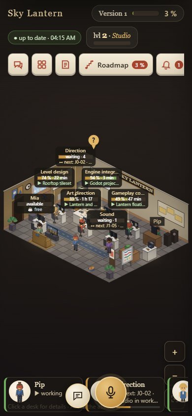
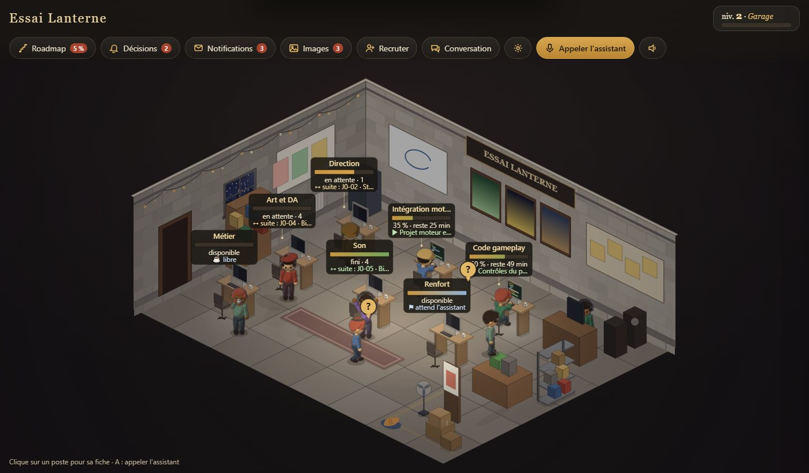
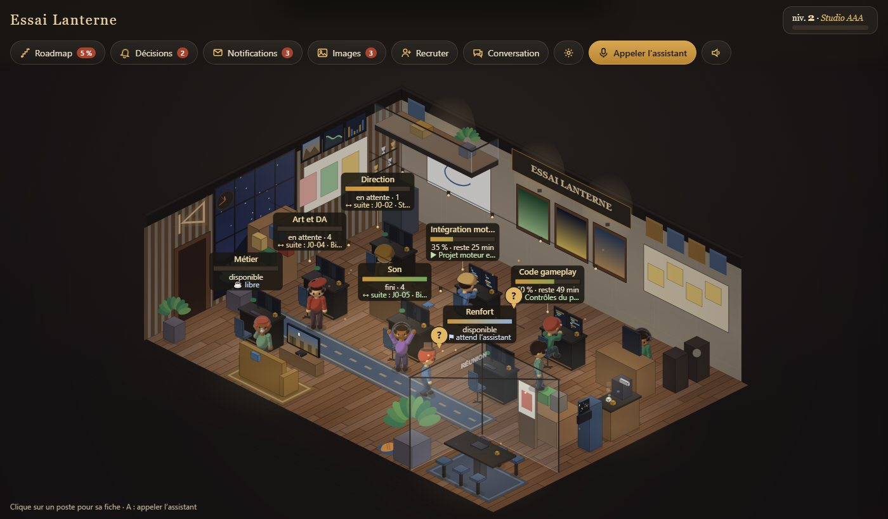

# studio-gamedev

*[Version française](README.md)*

**A [Claude Code](https://claude.com/claude-code) plugin that starts your video game like a game.**

Tell Claude "new game project". A small video game studio opens in your browser. Your assistant welcomes you and asks about the game you want to make: answer by clicking cards, typing or speaking. With each chapter, the studio builds itself around you. At the end, Claude writes your game's plan (the roadmap), the design document (GDD) and the working rules, then starts building it with you, step by step.

You don't need to know how to code to get started: you only need to know what you want to make.



## Screenshots

*Taken from a test project ("Sky Lantern", Godot, in English) with the skill exactly as you install it.*

| Day | Night |
|---|---|
|  |  |

| The questionnaire | First-run tutorial | On a phone |
|---|---|---|
|  |  |  |

To make these pictures yourself: `studio.html?palier=3&heure=14&apercu` (decor tier, time of day, no tutorial or notifications).

## What it does

1. **A game to create your game.** Eight chapters: vision, gameplay, world, art direction, sound, tech, ambition, characters. Each question offers illustrated cards, a recommended choice ★, a free text field and a microphone. Full mode (up to 96 questions that adapt to your answers) or quick mode (about 5 minutes).
2. **Your characters.** Your avatar and your assistant: name, look, personality, humour, language, how often it reports.
3. **The game plan.** A roadmap split into milestones (playable prototype first), with tasks, hour estimates and one achievement to unlock per milestone. Then the GDD, the decision log and a `CLAUDE.md` with working rules.
4. **The working studio.** An isometric page: one character per desk (code, art, sound…), its progress bar, the bell when a decision is waiting for you, your assistant's reports.
   A **Restructuring plan** button (top of the Overview panel) takes stock of the team (duplicate trades, idle agents, unclear names) and puts a plan of let-go and renames under the bell, each with its reason: nothing changes without "Apply the plan", a busy agent leaves after their task, and "Undo this plan" puts everything back.
   A **Whole team** button (top bar) shows everyone, even agents working outside the studio in a Claude chain, agent files with no desk, work bars and former members: state (at work, waiting, free, done), task, since when, model and effort. “Manage” renames, changes the trade, model or effort, lets go (an agent at work: after their task; protected agents never) or hires back, and archives a finished work bar: nothing is ever deleted.
5. **The work, milestone by milestone.** Each task goes to the installed game-dev skills (Godot, Unity, Unreal, Phaser, three.js, Bevy, Roblox…).

Built-in rules: one milestone at a time, short tests, a roadmap that is always true, and **nothing is published or pushed without your approval**.

## Your studio grows with your game

It starts as a **garage**: one desk, breeze-block walls, a bare bulb, string lights, boxes, a sleeping cat. The further your game gets, the nicer the studio becomes, over five tiers tied to the **studio level** and to **roadmap progress** (whichever is higher):

| Tier | Level | or roadmap | What arrives |
|---|---|---|---|
| 1. Garage | 1 | 0 % | concrete, breeze blocks, bulb, string lights, boxes, fan |
| 2. Small office | 5 | 15 % | light laminate, painted walls, plants, whiteboard, clock, pendant lights |
| 3. Studio | 10 | 35 % | desk island, coffee machine, sofa, TV and console, posters |
| 4. Pro studio | 16 | 60 % | parquet, wood panelling, glass meeting room, animated wall screens, warm lighting |
| 5. AAA studio | 24 | 90 % | mezzanine, glass roof and light shafts, arcade cabinet, trophies, neon, particles |

Each new tier plays out as a **building site** (scaffolding, dust, drill), then the new decor appears piece by piece. Colours and mood come from **your answers** to the questionnaire (palette, genre, emotion, world setting); the studio never uses your game's assets. Characters are 3D-rendered (8 directions, sitting, walking, coffee, cheering…), recoloured to their outfit, with headwear. To preview a tier: `studio.html?palier=3`.





## Installation

You need:
- [Claude Code](https://claude.com/claude-code) (with a Claude subscription or an API key);
- [Python](https://www.python.org/downloads/) 3.10 or newer (nothing else to install: the studio only uses the standard library; tested with Python 3.13, code checked against the 3.10 syntax). **Check it** in a terminal: `python --version` (on macOS and Linux: `python3 --version`; on Windows, `py --version` also works). On Windows, if the command opens the Microsoft Store or says "Python was not found", Python is not installed: install it from python.org and tick "Add python.exe to PATH".
- a recent browser (Chrome, Edge, Firefox…).

Open Claude Code and type these two lines, one after the other:

```
/plugin marketplace add xavfrech-dev/studio-gamedev
/plugin install studio-gamedev@studio-gamedev
```

Then type `/reload-plugins` (or quit Claude Code and start it again). Done.
**To check**: `/plugin` → installed plugins tab, or type `/studio-gamedev:studio`.

**Recommended**: the game-dev skills the studio hands the work to (it still works without them, just not as well):

```
/plugin marketplace add gamedev-skills/awesome-gamedev-agent-skills
/plugin install gamedev@awesome-gamedev-agent-skills
```

## First run, step by step

1. **Create an empty folder** for your game, for example `MyGame` (game already started? see "[Already have a project in progress?](#already-have-a-project-in-progress)").
2. **Open a terminal in that folder** and run `claude`.
3. **Type** `new game project` (or `/studio-gamedev:studio`).
4. Claude sets up the `.studio/` folder, starts a small server on your machine (reachable from your computer only) and opens `http://127.0.0.1:8790/studio.html`. If the browser does not open by itself, click the link Claude gives you. If port 8790 is taken, Claude picks another one and gives you the right address.
5. **Answer in the page.** No need to go back to Claude Code: it follows your answers and sometimes asks a follow-up question in the page. To go fast, pick the ★ choices.
6. After the last answer, the page shows "**Here is your roadmap**". Claude writes the project documents and offers to start the first milestone (a playable prototype). It asks for your approval before each important step.
7. **To resume later**, run `claude` again in the same folder and say `new game project` or `start a game studio`: everything is kept in `.studio/`.

Useful phrases afterwards: "status", "roadmap", "change the roadmap", "hire a composer", "make a playable build", "stop reports".

## Already have a project in progress?

It works too, even with a few hours of work and a foundation already in place. The studio settles **next to** your project; it does not rewrite it.

1. Open a terminal **in your game's folder** and run `claude`.
2. Type `adopt my project` (or `resume my game`, `new game`, `/studio-gamedev:studio`: a game already started is detected automatically).
3. Claude **reads** the project without changing anything: engine and version, scenes, what is already coded, assets, docs, code conventions, tests, TODOs, git history. It sums up what it understood in 5 lines and asks you to confirm before opening the studio.
4. The questionnaire is **shortened**: whatever can be deduced from the project is pre-filled (badge "deduced from the project"); you only answer the rest (vision, ambition, wishes, characters).
5. The roadmap starts from what exists: a first milestone "What already exists" (all checked, with the file or commit as proof), then "Taking it back in hand" and what comes next. No task redoes existing work; estimates are calibrated on your real pace (git history).

**What the studio never touches during adoption:**
- your code, scenes, assets and engine settings;
- your existing documents (`README.md`, `docs/ROADMAP.md`, `docs/GDD.md`, `docs/DECISIONS.md`, `docs/CHANGELOG.md`…): the studio's version is written **next to them** (`docs/ROADMAP.studio.md`…), or appended in a delimited `<!-- studio-gamedev -->` block **if you agree**;
- your `CLAUDE.md`: at most one delimited block appended at the end, with your consent; without it, the proposal stays in `.studio/propositions/`;
- your agents in `.claude/agents/`: kept as they are;
- your `.gitignore`: only the `.studio/` line is added, if missing.

Claude only creates files in `.studio/` (ignored by git). Before handing back, it compares every existing file with the snapshot taken at the start and tells you if one changed. No commit without your consent.

## What's new

0.5 brings quests and XP, the bell (decisions, spending approvals, things for you to do by hand), the « Je m'absente » (I'm away) button, the studio radio, PC health with a proposed cleanup, shared review, the studio host and the team restructuring plan. 0.5.1 (current version) keeps the studio working while you are away (with « Décidé à ta place », decided for you, when you come back), adds the Whole team view, one-click proposals from the assistant and safer writing of the studio files. Every version is detailed in the [CHANGELOG](CHANGELOG.md).

## On your phone

1. In Claude Code, say: "**open the studio on my phone**". Claude restarts the server with the network option and gives you an address (with a secret key) to open on the phone.
2. The phone must be on the **same Wi-Fi** as the computer (home network only). Windows may ask to allow Python on the private network: accept.
3. In the phone's browser, "Add to Home Screen": the studio then opens full screen like an app (Team, Conversation, Bell, Roadmap, Settings tabs).

Without this option, the studio can only be reached from the computer.

## Going further

- **The foreman** (optional, off by default, called "tyranny" in the settings): it walks around the desks, puts an idle agent back to work and says why an agent is blocked (your decision, the engine, another agent, a file, the machine, an error). When on, it **lets go by itself** a recruit that has had no work of its trade for 30 minutes (nothing is deleted: you can hire it again).
- **PC health**: the studio always measures the CPU, memory, disks and GPU. If the machine stays saturated for more than 15 minutes, or if the disk has less than 30 GB free, the automations wait. The "PC health" setting (off by default) only shows the Health agent and its alerts; the measuring and this brake always work. When a project disk fills up, a priced **cleanup** is proposed under the bell (engine caches, old builds, temporary files): nothing is deleted without "Do this cleanup", never outside the project and its caches, and **never the recycle bin**.
- **Studio host** (side quest, after the first playable prototype): you create a mood character that lives in a corner of the studio. It is not an agent: it costs no tokens.
- **Stop and resume**: say "stop the studio" (or `python -I -B <skill>/studio/outils/arreter.py --projet <project>`); when you resume, a server still running for this project is reused.
- **Assistant replies in the studio** (optional, only with your consent): a small script that Claude Code runs at the end of each reply (a "Stop hook") copies it to `.studio/journal_assistant.json` so the studio shows it. It is written to `<project>/.claude/settings.local.json`, merged with what is there (`.bak` copy). **Remove it**: `python -I -B <skill>/studio/outils/installer_crochet.py --projet <project> --retirer`.
- **Sensitive actions**: a click in the studio is not enough to publish, push, delete or spend credits: Claude Code still asks you. To allow one specific action for good, add it to `<project>/.claude/settings.local.json`:

  ```json
  { "permissions": { "allow": [ "Bash(git push origin main)", "Bash(python -I -B tools/export_build.py:*)" ] } }
  ```
  Only put commands there that you know and whose effect you accept without re-reading.

## Token cost

The studio makes Claude work, so it uses your subscription (or API key). The defaults are the most frugal:

| Setting | Default | What it means |
|---|---|---|
| `agents_max` | 2 | at most two agents at the same time |
| `modele_agents` | `sonnet` | agents use a cheaper model than the main one |
| `point_min` | 120 | an assistant report every 2 hours at most |
| `point_si_changement` | `true` | no report when nothing changed |
| `enchainer` | `false` | a finished task does not start the next one without your approval (unless you click « Je m'absente », I'm away) |
| `pause_si_absent_min` | 60 | if you stay silent for an hour **without** clicking « Je m'absente », nothing new is started (running work goes on) |
| `optimisation_auto` | `false` | no automatic project analysis (an optimisation request: only one pending, 30 min between two) |
| `attribution_auto` | `false` | at the end of a task, the character **waits for your choice**; at `true`, with no answer within 2 min the assistant gives it the next task (1 pending per character, 4 per hour) |
| `embauche_auto` | `false` | a trade is missing: the studio **reports it**; at `true`, it hires on its own (1 per hour, 12 desks, a hire is never started automatically) |

**« Je m'absente » (I'm away)**: the studio keeps going without you. The assistant chains the ready tasks and settles decisions by following its recommendation (★), writing down each choice and its reason. It keeps for your return anything that spends money, deletes, publishes or touches Windows. When you come back, it sums up what it « decided for you ». Sounds, bubbles, notifications and quests are off while you are away.

During the questionnaire, Claude waits for your answers with a small script that costs nothing (`attendre.py`): it never re-reads the page in a loop.

These settings live in `.studio/studio.config.json`, `economie` block. The easiest way is to ask Claude: "chain the tasks", "a report every hour", "three agents". It never changes them on its own. `attribution_auto` and `embauche_auto` can also be set in the page ("Settings"); when off, the server refuses these automations. Letting someone go is not automatic: the studio proposes it under the bell. Two exceptions, only if you turned these automations on: the foreman (see "Going further") and the end of a temp job (a temp reviewer is let go when its share of the review is done).

## Voice (optional)

- **Nothing to install**: Chrome and Edge recognise speech (through an online service of the browser). Firefox and Brave often do not: the page then switches to text.
- **On-device recognition** (nothing leaves your computer): install `faster-whisper` **with the same Python as the studio**: `python -m pip install faster-whisper` (a model is downloaded on first use), then **restart the studio**. On macOS and Linux, if `pip` refuses ("externally-managed-environment"), create a virtual environment (`python3 -m venv ~/.studio-venv`, then `~/.studio-venv/bin/pip install faster-whisper`) and ask Claude to run the studio with that Python. To make it faster, [ffmpeg](https://ffmpeg.org/download.html) in the PATH.
- To turn the microphone off: ask Claude, or set `voix.micro_actif` to `false` in `.studio/profil.json`.

## Privacy

- Everything stays on your machine. By default, the studio server only listens on `127.0.0.1` (the computer itself); with the phone option, it also listens on the home Wi-Fi and requires a secret key. It runs no command received from the page: only a few planned actions, on your click (restart the studio feed, run a cleanup you accepted, enable temperatures).
- **Only one change to the system, and only if you ask for it** (Windows): the "Enable temperatures" button of the PC health card creates the scheduled task "Studio gamedev - temperatures" (SYSTEM account, every 2 minutes and at startup) and the folder `%ProgramData%\StudioGamedev`. Windows asks "Yes" first. **To remove it**: ask Claude to uninstall the temperatures, or run in an administrator terminal `powershell -ExecutionPolicy Bypass -File <skill>/studio/outils/temperatures_windows.ps1 -Action Desinstaller` (task and folder removed).
- Your answers, profile and reports are in `<your game>/.studio/`. On the first run, Claude adds `.studio/` to your project's `.gitignore`: they are not uploaded to GitHub if you publish your game (only `roadmap.json` and `studio.config.json` may be, if you want).
- The studio stores no API key.
- If you open a project you did not create (a cloned repository), Claude shows you its configuration and waits for your approval before starting anything.

## Limits of version 0.5

- Developed and tested on Windows. macOS and Linux should work (standard-library Python only) but have not been tested yet.
- Claude does not drive your engine for you: it writes the code and runs what can be run from the command line (builds, tests). What shows on screen is yours to judge.
- Big productions (open world, online multiplayer) take a lot of tokens: start small.
- Voice depends on the browser.
- The skill's instructions are written in French; the questionnaire is available in French and English, and Claude answers in your language.
- Page language: the language of your first message (written in the project config); otherwise, the browser's.

## Recommended skills

The studio calls them **if they are installed**; they are not copied here and keep their own licence.

| Package | What it is for | Installation | Licence |
|---|---|---|---|
| [awesome-gamedev-agent-skills](https://github.com/gamedev-skills/awesome-gamedev-agent-skills) (`gamedev`) | Engines (Godot, Unity, Unreal, Phaser, three.js, Bevy, Roblox…), disciplines (AI, levels, sound, shaders…), genres and publishing (Steam, itch.io) | `/plugin marketplace add gamedev-skills/awesome-gamedev-agent-skills` then `/plugin install gamedev@awesome-gamedev-agent-skills` | Apache-2.0 |
| [Everything Claude Code](https://github.com/affaan-m/ECC) (`ecc`) | Review, tests, planning | `/plugin marketplace add affaan-m/ECC` then `/plugin install ecc@ecc` (if it mentions “userConfig” options to set with `/plugin configure ecc@ecc`: optional for the studio) | MIT |

The full table is in `skills/studio-gamedev/references/routage_skills.md`.

## Try the studio without a project

Simplest: in Claude Code, say “**try the studio without a project**”. Otherwise, from a copy of the repository:

```bash
git clone https://github.com/xavfrech-dev/studio-gamedev && cd studio-gamedev
python -I -B skills/studio-gamedev/studio/outils/essai_complet.py tout --dossier <some folder>/essai_skill
python -I -B skills/studio-gamedev/studio/outils/essai_complet.py serveur --dossier <some folder>/essai_skill --port 8810
```

Then open the address shown (`http://127.0.0.1:8810/studio.html`, or the next free port). Ctrl+C to stop.

## Repository contents

| Path | Contents |
|---|---|
| `skills/studio-gamedev/SKILL.md` | The skill's flow (phases 0 to 6) |
| `skills/studio-gamedev/references/` | Questionnaire, skill routing, working rules, deliverables, studio contract |
| `skills/studio-gamedev/modeles/` | Templates: GDD, ROADMAP, DECISIONS, CLAUDE.md, agent, config, profile, roadmap |
| `skills/studio-gamedev/studio/` | The studio page, its local server, the office feeder and its watchdog, the questionnaire, 264 code-drawn SVG illustrations, the decor tiers (`paliers.js`) and the rendered characters (`sprites/`, rendering tools in `outils/sprites/`) |
| `commands/studio.md` | The `/studio-gamedev:studio` command |
| `commands/point-equipe.md` | The `/studio-gamedev:point-equipe` command (short form `/point-equipe` as long as no other plugin uses that name) |
| `.claude-plugin/` | Plugin and marketplace manifests |

## Licence

MIT, © 2026 xavfrech-dev. See [LICENSE](LICENSE). Release history: [CHANGELOG.md](CHANGELOG.md).
