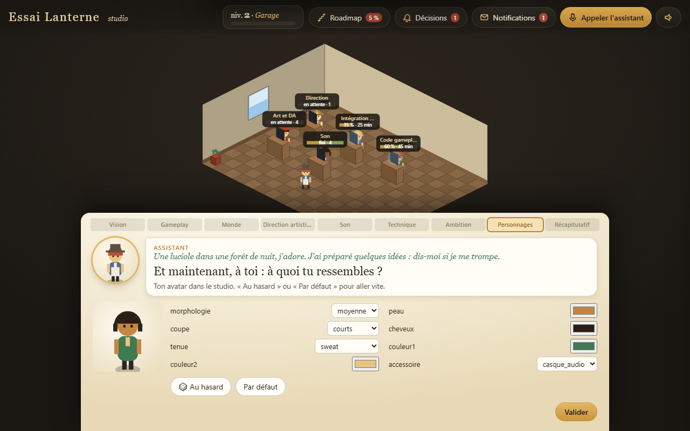
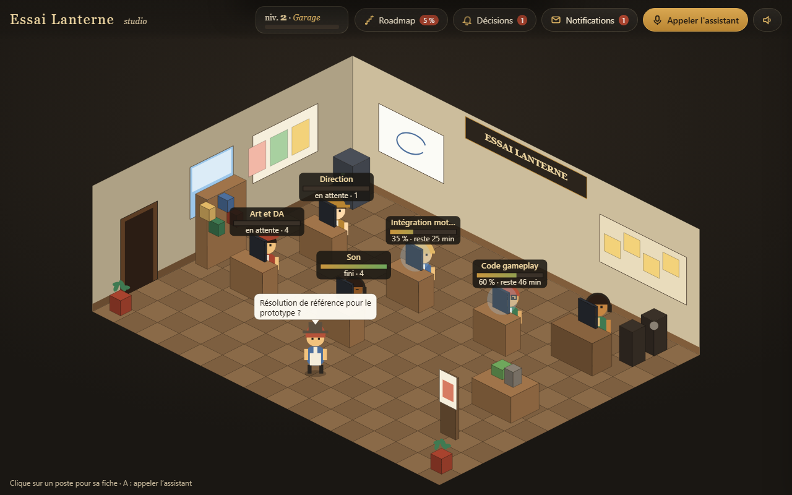
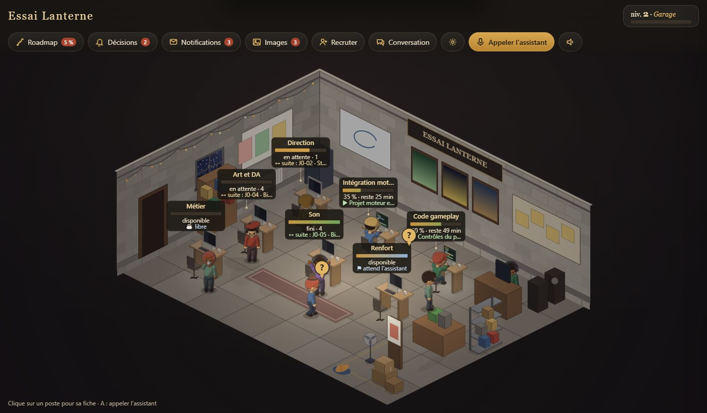
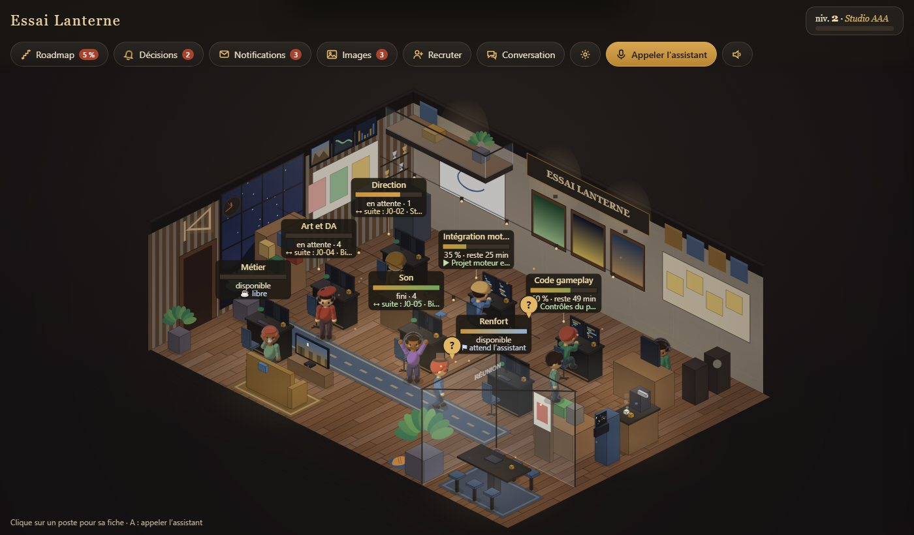

# studio-gamedev

*[English version](README.en.md)*

**Un plugin pour [Claude Code](https://claude.com/claude-code) qui lance ton jeu vidéo comme un jeu.**

Tu dis « nouveau jeu » à Claude. Un petit studio de jeu vidéo s'ouvre dans ton navigateur. Ton assistant t'accueille et te pose des questions sur le jeu que tu veux faire : tu réponds en cliquant sur des cartes, en écrivant ou en parlant. À chaque chapitre, le studio se construit autour de toi. À la fin, Claude écrit le plan de ton jeu (la roadmap), le document de conception (GDD) et les règles de travail, puis commence à le fabriquer avec toi, étape par étape.

Pas besoin de savoir programmer pour commencer : il suffit de savoir ce que tu as envie de faire.





## Ce que ça fait

1. **Un jeu pour créer ton jeu.** Huit chapitres : vision, gameplay, monde, direction artistique, son, technique, ambition, personnages. Chaque question propose des cartes illustrées, un choix conseillé ★, un champ libre et un micro. Mode complet (jusqu'à 96 questions qui s'adaptent à tes réponses) ou mode rapide (environ 5 minutes).
2. **Tes personnages.** Ton avatar et ton assistant : nom, apparence, caractère, humour, langue, fréquence de ses rapports.
3. **Le plan du jeu.** Une roadmap découpée en jalons (prototype jouable d'abord), avec des tâches, des estimations en heures et un succès à débloquer par jalon. Puis le GDD, le journal des décisions et un `CLAUDE.md` avec les règles de travail.
4. **Le studio de travail.** Une page en vue isométrique : un personnage par poste (code, art, son…), sa barre de progression, la cloche quand une décision t'attend, les rapports de ton assistant.
5. **Le travail, jalon par jalon.** Chaque tâche est confiée aux skills de game dev installés (Godot, Unity, Unreal, Phaser, three.js, Bevy, Roblox…).

Règles intégrées : un jalon à la fois, des tests courts, une roadmap toujours vraie, et **rien n'est publié ni poussé sans ton accord**.

## Ton studio grandit avec ton jeu

Au début, c'est un **garage** : un bureau, des murs en parpaings, une ampoule, une guirlande, des cartons, un chat qui dort. Plus ton jeu avance, plus le studio embellit, en cinq paliers liés au **niveau du studio** et à l'**avancement de la roadmap** (le plus haut des deux) :

| Palier | Niveau | ou roadmap | Ce qui arrive |
|---|---|---|---|
| 1. Garage | 1 | 0 % | béton, parpaings, ampoule, guirlande, cartons, ventilateur |
| 2. Petit bureau | 5 | 15 % | stratifié clair, murs peints, plantes, tableau blanc, horloge, suspensions |
| 3. Studio | 10 | 35 % | îlot, machine à café, canapé, télé et console, affiches |
| 4. Studio pro | 16 | 60 % | parquet, lambris, salle de réunion vitrée, écrans muraux animés, éclairage chaud |
| 5. Studio AAA | 24 | 90 % | mezzanine, verrière et rais de lumière, borne d'arcade, trophées, néon, particules |

Chaque passage de palier se joue en **chantier** (échafaudage, poussière, perceuse), puis le nouveau décor apparaît pièce par pièce. Les couleurs et l'ambiance viennent de **tes réponses** au questionnaire (palette, genre, émotion, cadre du monde) ; le studio n'utilise jamais d'asset de ton jeu. Les personnages sont rendus en 3D (8 directions, assis, marche, café, joie…), recolorés à leur tenue, avec couvre-chefs. Pour revoir un palier : `studio.html?palier=3`.





## Installation

Il te faut :
- [Claude Code](https://claude.com/claude-code) (avec un abonnement Claude ou une clé d'API) ;
- [Python](https://www.python.org/downloads/) 3.10 ou plus récent (rien d'autre à installer : le studio n'utilise que la bibliothèque standard) ;
- un navigateur récent (Chrome, Edge, Firefox…).

Ouvre Claude Code et tape ces deux lignes, l'une après l'autre :

```
/plugin marketplace add xavfrech-dev/studio-gamedev
/plugin install studio-gamedev@studio-gamedev
```

Puis quitte Claude Code et relance-le. C'est installé.

**Conseillé** : les skills de game dev auxquels le studio confie le travail (sans eux, ça marche quand même, mais moins bien) :

```
/plugin marketplace add gamedev-skills/awesome-gamedev-agent-skills
/plugin install gamedev@awesome-gamedev-agent-skills
```

## Premier lancement, pas à pas

1. **Crée un dossier vide** pour ton jeu, par exemple `MonJeu` (jeu déjà commencé ? voir « [Tu as déjà un projet en cours ?](#tu-as-déjà-un-projet-en-cours-) »).
2. **Ouvre un terminal dans ce dossier** et lance `claude`.
3. **Tape** `nouveau jeu` (ou `/studio-gamedev:studio`).
4. Claude prépare le dossier `.studio/`, démarre un petit serveur sur ta machine (accessible seulement depuis ton ordinateur) et ouvre la page `http://127.0.0.1:8790/studio.html`. Si le navigateur ne s'ouvre pas tout seul, clique sur le lien que Claude te donne. Si le port 8790 est pris, Claude en prend un autre et te donne la bonne adresse.
5. **Réponds dans la page.** Pas besoin de revenir dans Claude Code : il suit tes réponses et te pose parfois une question de plus dans la page. Pour aller vite, prends les choix ★.
6. À la dernière réponse, la page affiche « **Voici ta roadmap** ». Claude écrit les documents du projet et te propose de lancer le premier jalon (un prototype jouable). Il te demande ton accord avant chaque étape importante.
7. **Pour reprendre plus tard**, relance `claude` dans le même dossier et redis `nouveau jeu` ou `lance le studio` : tout est gardé dans `.studio/`.

Phrases utiles ensuite : « point », « roadmap », « change la roadmap », « recrute un musicien », « version », « stop suivi ».

## Tu as déjà un projet en cours ?

Ça marche aussi, même avec quelques heures de travail et un socle déjà monté. Le studio s'installe **à côté** de ton projet, il ne le réécrit pas.

1. Ouvre un terminal **dans le dossier de ton jeu** et lance `claude`.
2. Tape `adopte mon projet` (ou `reprends mon jeu`, `nouveau jeu`, `/studio-gamedev:studio` : le jeu déjà commencé est reconnu tout seul).
3. Claude **lit** le projet sans rien modifier : moteur et version, scènes, ce qui est déjà codé, assets, docs, conventions de code, tests, TODO, historique git. Il te résume ce qu'il a compris en 5 lignes et te demande si c'est bien ça avant d'ouvrir le studio.
4. Le questionnaire est **raccourci** : ce qui se déduit du projet est déjà rempli (badge « déduit du projet »), tu ne réponds qu'au reste (vision, ambition, envies, personnages).
5. La roadmap part de l'existant : un premier jalon « Ce qui existe déjà » (tout est coché, avec le fichier ou le commit en preuve), puis « Reprise en main » et la suite. Aucune tâche ne refait ce qui existe ; les estimations sont calées sur ton rythme réel (historique git).

**Ce que le studio ne touche jamais pendant l'adoption :**
- ton code, tes scènes, tes assets, les réglages du moteur ;
- tes documents existants (`README.md`, `docs/ROADMAP.md`, `docs/GDD.md`, `docs/DECISIONS.md`, `docs/CHANGELOG.md`…) : la version du studio est écrite **à côté** (`docs/ROADMAP.studio.md`…), ou ajoutée à la fin dans un bloc délimité `<!-- studio-gamedev -->` **si tu es d'accord** ;
- ton `CLAUDE.md` : au plus un bloc délimité ajouté à la fin, après ton accord ; sans accord, la proposition reste dans `.studio/propositions/` ;
- tes agents dans `.claude/agents/` : gardés tels quels ;
- ton `.gitignore` : seule la ligne `.studio/` est ajoutée, si elle manque.

Claude ne crée de fichiers que dans `.studio/` (ignoré par git). Avant de te rendre la main, il compare chaque fichier existant à la photo prise au départ et te prévient si l'un d'eux a changé. Aucun commit sans ton accord.

## Nouveautés de la 0.2

- **Bulles de décision dans la scène** : quand une décision t'attend, un « ? » doré flotte au-dessus du personnage concerné (sinon au-dessus de l'assistant, avec un compteur). Un clic l'ouvre en grand : choix, champ libre ou micro. Une fois répondue, la bulle s'envole.
- **Conversation avec l'assistant** (nouveau bouton) : tes messages avec leur statut (déposé, lu, traité), ses réponses et ses décisions avec boutons. Si sa réponse finit par une question sans décision, une bulle « L'assistant te pose une question » apparaît.
- **Fin de tâche** : le personnage qui a fini va attendre près de l'assistant. Sa fiche propose « Lui confier une tâche », « Trouve-toi une tâche » ou « Laisser en pause ». Rien n'est lancé sans toi, sauf si tu actives l'attribution automatique.
- **Embauche et renvoi** : bouton « Renvoyer… » sur les recrues (avec confirmation, refusé si une tâche est en cours, rien n'est effacé) et liste « Anciens » pour réembaucher. Le studio peut proposer un renvoi sous la cloche, jamais l'appliquer seul.
- **Plus solide** : une veille (`studio/veille_studio.py`) relance l'alimentation si elle s'arrête ; bandeau rouge si l'état de la page date de plus d'une minute ; fichier illisible ignoré et signalé ; demandes jamais écrasées.

## Coût en jetons

Le studio fait travailler Claude, donc il consomme ton abonnement (ou ta clé d'API). Les réglages par défaut sont les plus sobres :

| Réglage | Par défaut | Ce que ça veut dire |
|---|---|---|
| `agents_max` | 2 | deux agents au plus en même temps |
| `modele_agents` | `sonnet` | les agents utilisent un modèle moins cher que le modèle principal |
| `point_min` | 120 | un rapport de ton assistant toutes les 2 heures au plus souvent |
| `point_si_changement` | `true` | pas de rapport si rien n'a bougé |
| `enchainer` | `false` | une tâche finie ne lance pas la suivante sans ton accord : rien ne tourne pendant ton absence |
| `pause_si_absent_min` | 60 | après une heure sans nouvelles de toi, plus rien n'est lancé |
| `optimisation_auto` | `false` | pas d'analyse automatique du projet (une demande d'optimisation : une seule en attente, 30 min entre deux) |
| `attribution_auto` | `false` | en fin de tâche, le personnage **attend ton choix** ; à `true`, sans réponse en 2 min l'assistant lui confie la tâche suivante (1 en attente par personnage, 4 par heure) |
| `embauche_auto` | `false` | un métier manque : le studio **le signale** ; à `true`, il embauche seul (1 par heure, 12 bureaux, recrue jamais lancée d'office) |

Pendant le questionnaire, Claude attend tes réponses avec un petit script qui ne consomme rien (`attendre.py`) : il ne relit pas la page en boucle.

Ces réglages sont dans `.studio/studio.config.json`, bloc `economie`. Le plus simple est de demander à Claude : « enchaîne les tâches », « un point toutes les heures », « trois agents ». Il ne les change jamais de lui-même. `attribution_auto` et `embauche_auto` se règlent aussi dans la page (« Réglages ») ; coupés, le serveur refuse ces automatismes. Les renvois ne sont jamais automatiques.

## Voix (facultatif)

- **Sans rien installer** : Chrome et Edge reconnaissent la voix (elle passe par un service en ligne du navigateur). Firefox et Brave ne le font souvent pas : la page bascule alors sur l'écrit.
- **Reconnaissance sur ta machine** (rien ne sort de ton ordinateur) : installe `faster-whisper` (`pip install faster-whisper` ; un modèle est téléchargé au premier usage) et, pour aller plus vite, [ffmpeg](https://ffmpeg.org/download.html) dans le PATH.
- Pour couper le micro : demande-le à Claude, ou mets `voix.micro_actif` à `false` dans `.studio/profil.json`.

## Confidentialité

- Tout reste sur ta machine. Le serveur du studio n'écoute que `127.0.0.1` et n'exécute aucune commande reçue de la page.
- Tes réponses, ton profil et les rapports sont dans `<ton jeu>/.studio/`. Dès le premier lancement, Claude ajoute `.studio/` au `.gitignore` de ton projet : ils ne partent pas sur GitHub si tu publies ton jeu (seuls `roadmap.json` et `studio.config.json` peuvent l'être, si tu le veux).
- Aucune clé d'API n'est stockée par le studio.
- Si tu ouvres un projet que tu n'as pas créé (un dépôt cloné), Claude te montre sa configuration et attend ton accord avant de lancer quoi que ce soit.

## Limites de la version 0.3

- Développé et essayé sous Windows. macOS et Linux devraient marcher (Python standard seulement) mais n'ont pas encore été essayés.
- Claude ne pilote pas ton moteur à ta place : il écrit le code et lance ce qui se lance en ligne de commande (builds, tests). Ce qui se voit à l'écran, c'est toi qui le juges.
- Les grosses productions (monde ouvert, multijoueur en ligne) demandent beaucoup de jetons : commence petit.
- La voix dépend du navigateur.
- Les consignes du skill sont écrites en français ; le questionnaire existe en français et en anglais, et Claude te répond dans ta langue.

## Skills conseillés

Le studio les appelle **s'ils sont installés** ; ils ne sont pas copiés ici et gardent leur propre licence.

| Paquet | À quoi il sert | Installation | Licence |
|---|---|---|---|
| [awesome-gamedev-agent-skills](https://github.com/gamedev-skills/awesome-gamedev-agent-skills) (`gamedev`) | Moteurs (Godot, Unity, Unreal, Phaser, three.js, Bevy, Roblox…), disciplines (IA, niveaux, son, shaders…), genres et publication (Steam, itch.io) | `/plugin marketplace add gamedev-skills/awesome-gamedev-agent-skills` puis `/plugin install gamedev@awesome-gamedev-agent-skills` | Apache-2.0 |
| [Everything Claude Code](https://github.com/affaan-m/ECC) (`ecc`) | Relecture, tests, planification | `/plugin marketplace add affaan-m/ECC` puis `/plugin install ecc@ecc` | MIT |

La table complète est dans `skills/studio-gamedev/references/routage_skills.md`.

## Essayer le studio sans projet

Depuis le dossier du dépôt cloné :

```bash
python -I -B skills/studio-gamedev/studio/outils/essai_complet.py tout --dossier <un dossier>/essai_skill
python -I -B skills/studio-gamedev/studio/outils/essai_complet.py serveur --dossier <un dossier>/essai_skill --port 8810
```

Puis ouvre l'adresse affichée (`http://127.0.0.1:8810/studio.html`, ou le port libre suivant). Ctrl+C pour arrêter.

## Contenu du dépôt

| Chemin | Contenu |
|---|---|
| `skills/studio-gamedev/SKILL.md` | Le déroulé du skill (phases 0 à 6) |
| `skills/studio-gamedev/references/` | Questionnaire, routage vers les skills, règles de travail, livrables, contrat du studio |
| `skills/studio-gamedev/modeles/` | Gabarits : GDD, ROADMAP, DECISIONS, CLAUDE.md, agent, config, profil, roadmap |
| `skills/studio-gamedev/studio/` | La page du studio, son serveur local, l'alimentation du bureau et sa veille, le questionnaire, 264 illustrations SVG tracées par code, les paliers du décor (`paliers.js`) et les personnages rendus (`sprites/`, outils de rendu dans `outils/sprites/`) |
| `commands/studio.md` | La commande `/studio-gamedev:studio` |
| `.claude-plugin/` | Manifeste du plugin et de la place de marché |

## Licence

MIT, © 2026 xavfrech-dev. Voir [LICENSE](LICENSE). Historique des versions : [CHANGELOG.md](CHANGELOG.md).
